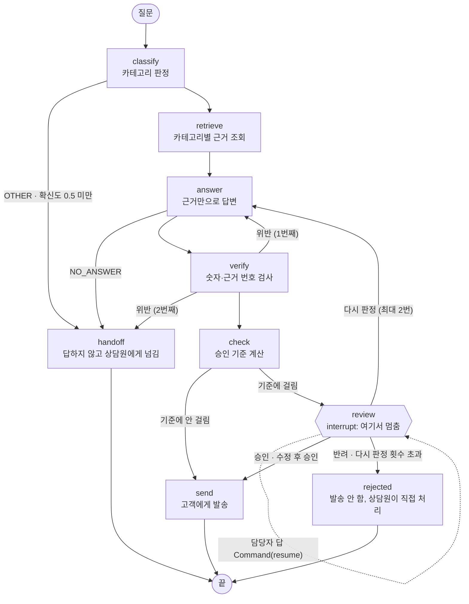

# REPORT — 사람이 승인하는 인적공제 상담 에이전트

- 실행 날짜: 2026-11-14
- 모델: 판정 `gpt-5.6-luna`, 답변·채점 `gpt-5.6-terra` (OpenAI)
- `[작성 필요]`라고 적힌 곳은 담당자가 데모 화면에서 대기 건을 처리한 뒤에 채웁니다.

## 1. 주제와 고른 이유

**자동화한 업무**: 2025년 귀속 인적공제 질문에 근거 문서만으로 답하는 상담 답변 자동 발송입니다. 라우팅 과제([tax-routing-agent](https://github.com/ctaleez51-art/tax-routing-agent))에서 만든 "판정 → 근거 조회 → 답변 → 검증" 파이프라인에 승인 단계를 붙였습니다.

**결과가 바깥으로 나가는 단계**: 답변을 고객에게 보내는 `send` 단계입니다. 판정·근거 조회·답변·검증은 잘못되면 다시 하면 되지만, 고객이 읽은 답은 되돌릴 수 없습니다. 고객은 그 답을 믿고 연말정산 공제를 신청하고, 답이 틀렸으면 공제를 못 받거나 잘못 받아 나중에 세금을 더 내야 합니다.

**고른 이유**: 라우팅 과제에서 답변 적절성이 0.955였습니다. 22건 중 1건은 틀린 답이 그대로 나갔다는 뜻이고, 그 1건(장애인 동생 공제에서 장애인증명서 요건 누락)은 숫자·근거 번호 검증을 통과했습니다. 정확도를 더 올리는 것과 별개로, 틀린 답이 나가기 전에 사람이 막을 자리가 필요했습니다.

## 2. 파이프라인 구조도

**멈추는 지점**은 `review` 한 곳이고, 바깥으로 나가는 `send` 바로 앞입니다. **재개 경로**는 담당자 답에 따라 `send`, `answer`(다시 판정), `rejected` 세 갈래입니다. 다시 판정으로 새로 쓴 답은 검증과 승인 기준 계산을 다시 거쳐 반드시 `review`로 돌아옵니다.

재개하면 `review` 단계가 첫 줄부터 다시 실행됩니다. 그래서 `review` 안에는 `interrupt` 앞에 바깥으로 나가는 동작을 두지 않았고, 발송은 `send` 단계로 따로 뗐습니다.

**상태(State)** — [agent.py](agent.py)의 `State`

| 값 | 채우는 단계 | 내용 |
|---|---|---|
| `question`, `received_at` | 입력 | 고객 질문, 받은 시각 |
| `categories`, `confidence`, `reason` | classify | 카테고리 1~2개, 확신도, 판정 이유 |
| `context`, `chunk_ids`, `tools_called` | retrieve | 근거 본문, 근거 번호, 부른 도구 |
| `answer`, `attempts` | answer | AI 답변, 몇 번째에 쓴 답인지 |
| `checks`, `problems` | verify | 검증 결과, 위반 내용 |
| `stop_reasons` | check | 걸린 승인 기준 |
| `decisions`, `rejudges`, `instruction` | review | 담당자 답 기록, 다시 판정 횟수, 담당자 지시 |
| `status`, `sent_answer`, `sent_by`, `finished_at` | send · rejected · handoff | 결과, 고객에게 실제로 나간 글, 누가 통과시켰는지 |

**대기 건 저장**: 체크포인터는 `SqliteSaver`이고 파일은 `store/checkpoints.sqlite`입니다. 질문 한 건이 `thread_id` 하나입니다. `run_batch.py`가 질문을 넣고 끝난 뒤에 따로 띄운 `app.py`에서 대기 14건이 그대로 보이는 것을 확인했습니다. 3일 넘게 대기한 건은 자동 반려해 상담원이 직접 처리하게 했습니다(자동 승인은 하지 않습니다).

## 3. 승인 기준과 그 이유

### 기준을 정한 방식

처음에는 "분류 확신도 0.7 미만"을 기준으로 생각했습니다. 그런데 이번 실행에서도 확신도는 모든 건이 0.96 이상이어서 이 기준으로는 한 건도 멈추지 않았습니다. 틀린 답도 확신도는 0.99였습니다. 그래서 "모델이 틀릴 것 같은 건"을 찾는 대신 **"틀렸을 때 손해가 큰 건"을 질문의 성격으로 고르는** 방식으로 바꿨습니다.

기준을 검증하려면 틀리는 답이 있어야 해서, 라우팅 과제 질문 22건에 **어려운 질문 12건**을 더했습니다([data/goldenset.json](data/goldenset.json)의 H01~H12). 정보가 빠진 질문, 기준선 바로 아래 금액, 월 금액을 연 금액으로 바꿔야 하는 질문, 예외 규칙이 적용되지 않는 경우, 연도가 헷갈리는 질문 등입니다.

"사람이 봐야 하는 건"은 **채점에서 틀린 답**으로 정했습니다. 질문마다 꼭 들어가야 할 사실(must)과 들어가면 안 되는 사실(forbid)을 미리 적어 두고 채점 모델이 답변을 판정합니다. 채점기는 모범 답안 30/30 통과, forbid로 만든 오답 30/30 탈락으로 먼저 검증했습니다.

### 쓰는 기준

하나라도 걸리면 멈춥니다. 모두 LLM 없이 코드로 계산합니다([criteria.py](criteria.py)).

| 기준 (계산 방법) | 대비하는 위험 | 실제로 잡은 틀린 답 |
|---|---|---|
| **두 카테고리에 걸친 질문** (판정 카테고리가 2개) | 두 규칙을 합쳐 판단하다가 요건 하나를 빠뜨림 | M02, H07 |
| **질문이나 답변에 '장애'가 들어감** | 장애인 공제는 장애인증명서 같은 서류 요건이 있는데, 이를 빠뜨리면 고객이 공제를 잘못 신청함 | M02, H07 |
| **질문에 금액이 들어감** (예: "600만원", "매달 45만원") | 고객이 금액을 대며 물으면 답이 금액 비교에 달려 있어, 비교를 틀리거나 빼먹으면 '공제 가능'과 '불가'가 뒤바뀜 | H02, H04 |
| **질문에 2025년이 아닌 연도가 들어감** ("2024년", "작년", "내년" 등) | 자료가 2025년 귀속 기준이라, 다른 연도의 일을 물으면 어느 해 연말정산에 적용되는지 혼동함 | H11 (1차 실행) |
| **담당자가 다시 판정을 요청해 새로 쓴 답** | 새로 쓴 답을 아무도 확인하지 않고 내보냄 | (운영 규칙) |

잡은 틀린 답의 예:

- **H02** "아버지가 국민연금을 매달 45만원씩 받으시는데 기본공제 되나요?" → AI는 "네. 가능합니다 … 매달 45만원은 이에 해당합니다"라고 답했습니다. 연 540만원이라 기준 5,166,667원을 넘으므로 반대가 정답입니다.
- **M02** "25세 장애인 동생 … 무엇이 필요한가요?" → 나이·소득 요건만 답하고 장애인증명서가 필요하다는 내용을 빠뜨렸습니다.

### 자동으로 처리되는 건과 그 이유

기준에 걸리지 않는 건은 **카테고리가 하나이고, 금액 비교가 없고, 서류 요건이 붙는 장애인 공제가 아니고, 2025년 귀속만 묻는 질문**입니다. 자료의 Q&A 한 조각에 답이 그대로 있어서 여러 규칙을 합치거나 계산할 일이 없습니다. 2차 실행에서 자동 발송된 15건은 채점에서 모두 통과했습니다.

- F01 "결혼식은 안 하고 혼인신고만 했는데 배우자 공제 되나요?"
- E02 "부녀자 공제와 한부모 공제를 같이 받을 수 있나요?"
- C03 "기본공제 받는 손자도 자녀세액공제 받을 수 있나요?"

인적공제와 관계없는 질문(OTHER)과 근거에 답이 없는 질문은 승인 단계까지 오지 않고, 답변 없이 상담원에게 넘어갑니다(`handoff`). 틀린 답이 나갈 일이 없어서 승인 대상이 아닙니다.

### 기준 후보 비교

같은 답변에 기준 후보를 하나씩 적용해 세 값을 셌습니다. **놓침**은 틀린 답인데 멈추지 않아 그대로 발송되는 건, **헛멈춤**은 맞는 답인데 멈춘 건입니다.

기준은 1차 실행을 보고 골랐고, 고른 기준으로 저장소를 비우고 처음부터 다시 돌린 것이 2차 실행입니다. 전체 표는 [results/criteria-run1.md](results/criteria-run1.md), [results/criteria.md](results/criteria.md)에 있습니다.

| 멈춤 기준 | 1차: 개입 | 놓침 | 헛멈춤 | 2차: 개입 | 놓침 | 헛멈춤 |
|---|---|---|---|---|---|---|
| 기준 없음 (전부 자동) | 0/30 | 5 | 0 | 0/29 | 4 | 0 |
| 확신도 0.7 미만 | 0/30 | 5 | 0 | 0/29 | 4 | 0 |
| 답변에 금액이 들어감 | 19/30 | 0 | 14 | 18/29 | 0 | 14 |
| 두 카테고리 | 5/30 | 3 | 3 | 4/29 | 2 | 2 |
| '장애' 포함 | 4/30 | 3 | 2 | 4/29 | 2 | 2 |
| 질문 금액이 기준 금액의 ±25% 안 | 6/30 | 4 | 5 | 7/29 | 2 | 5 |
| 질문에 금액 | 8/30 | 3 | 6 | 8/29 | 2 | 6 |
| 두 카테고리 + '장애' | 7/30 | 3 | 5 | 6/29 | 2 | 4 |
| 두 카테고리 + '장애' + 기준 금액 ±25% | 12/30 | 2 | 9 | 12/29 | 0 | 8 |
| 두 카테고리 + '장애' + 질문에 금액 | 14/30 | 1 | 10 | 13/29 | 0 | 9 |
| **두 카테고리 + '장애' + 질문에 금액 + 다른 연도 (쓰는 기준)** | **16/30** | **0** | **11** | **14/29** | **0** | **10** |
| 전부 멈춤 | 30/30 | 0 | 25 | 29/29 | 0 | 25 |

고른 까닭:

1. **놓침이 헛멈춤보다 비쌉니다.** 놓침은 틀린 세금 안내가 고객에게 나가는 것이고, 헛멈춤은 담당자가 맞는 답을 한 번 읽고 승인하는 것입니다. 그래서 놓침이 0인 기준 가운데 개입이 가장 적은 쪽을 골랐습니다.
2. **"답변에 금액이 들어감"은 놓침은 0이지만 헛멈춤이 14건**입니다. "50만원 공제"처럼 금액을 안내만 하는 답까지 모두 멈춥니다. 금액을 "질문에" 들어간 경우로 좁히니 헛멈춤이 6건으로 줄었습니다.
3. **"기준 금액 ±25%"는 "질문에 금액"보다 개입이 적지만 1차에서 H04를 놓쳤습니다.** 이 기준은 답변에 적힌 기준 금액과 비교하는데, H04 답변은 판단에 필요한 금액(3,333,333원)을 아예 쓰지 않았기 때문입니다. 답변 글에 기대는 기준은 답변이 빼먹으면 같이 빠집니다. 질문만 보는 기준은 같은 질문이면 항상 같은 결과가 나옵니다.
4. **"다른 연도"는 H11 때문에 넣었습니다.** 1차에서 AI는 2024년 혼인신고를 2025년 귀속 연말정산에서 공제받을 수 있다고 틀리게 답했습니다. 2차에서는 같은 질문을 범위 밖으로 판정해 상담원에게 넘겼습니다. 실행마다 갈리는 질문이라 기준으로 고정해 두었습니다. 대신 "작년에는 형이…"로 시작하는 H10이 헛멈춤이 됩니다.

2차 실행을 문항 묶음별로 보면, 라우팅 과제 문항은 18건 중 6건(33%), 어려운 문항은 11건 중 8건이 멈췄습니다. 전체 개입 48%는 일부러 어려운 질문을 많이 넣은 세트의 값입니다.

## 4. 실행 결과

2차 실행 기준입니다. 건별 기록은 [results/summary.md](results/summary.md)에 있습니다.

| | 건수 | 문항 |
|---|---|---|
| 처리한 질문 | 34 | |
| 답하지 않고 상담원에게 넘김 | 5 | O01~O04, H11 (모두 범위 밖 판정) |
| 답변까지 간 건 | 29 | |
| └ 자동 발송 | 15 | F01~F04, I02, E01~E03, C01~C04, H01, H09, H12 |
| └ 승인 기준에 걸려 멈춤 | 14 | I01, I03, I04, E04, M01, M02, H02~H08, H10 |

기준별로 걸린 건수(한 건이 두 기준에 걸리기도 합니다): 두 카테고리 4건, '장애' 4건, 질문에 금액 8건, 다른 연도 1건.

멈춘 14건 가운데 채점에서 틀린 답은 4건(M02, H02, H04, H07), 맞는 답은 10건입니다. 자동 발송된 15건 가운데 틀린 답은 없었습니다.

### 멈춘 건을 사람이 어떻게 처리했는지

`[작성 필요]` 데모 화면에서 14건에 답을 준 뒤 `python run_batch.py --summary`를 실행하면 [results/summary.md](results/summary.md)의 "담당자 답" 칸이 채워집니다. 그 결과를 아래 표에 옮깁니다.

| 담당자 답 | 건수 | 문항 |
|---|---|---|
| 승인 | | |
| 수정 후 승인 | | |
| 반려 | | |
| 다시 판정 | | |

## 5. 데모 화면 설계

[app.py](app.py) (Streamlit). 목표는 담당자가 다른 시스템을 열지 않고 이 화면만 보고 판단하는 것입니다.

**승인 대기 탭**에 대기 목록이 있고, 한 건을 고르면 아래 다섯 가지가 순서대로 보입니다.

| 보여 주는 것 | 까닭 |
|---|---|
| ① 고객 질문 원문 | 무엇을 물었는지 |
| ② AI 답변 | 승인하면 이 글이 그대로 나감 |
| ③ AI 판정(카테고리·확신도·이유)과 답변이 인용한 근거 원문 | 규정 문서를 따로 찾지 않고 답과 근거를 맞춰 보기 위해. 근거는 접어 두고 필요할 때 펼침 |
| ④ 멈춘 이유와 그 기준이 대비하는 위험 | 이 건에서 무엇을 봐야 하는지 알려 줌 (예: 금액 비교) |
| ⑤ 승인하면 일어나는 일 | "고객에게 그대로 발송되고 되돌릴 수 없다"를 버튼 위에 둠 |

담당자 답은 네 가지입니다.

| 답 | 그 뒤에 일어나는 일 |
|---|---|
| 승인 | AI 답변을 그대로 발송 |
| 수정 후 승인 | 담당자가 고친 글을 발송. AI 답변은 기록에 남음 |
| 반려 (사유 필수) | 발송하지 않고 상담원이 직접 처리. 사유는 기록에 남음 |
| 다시 판정 (지시 필수, 최대 2번) | 지시를 붙여 AI가 다시 답하고, 새 답은 다시 승인 대기로 옴. 2번을 넘으면 반려 |

**뺀 것**

- 조립한 근거 전체(카테고리 하나에 약 7천~2만 글자): 답변이 인용한 조각만 보여 줍니다.
- 검증 단계의 세부 값(답변에서 찾은 숫자 목록 등)과 부른 도구 이름: 검증을 통과한 건만 여기까지 오므로 판단에 쓰이지 않습니다.
- 채점 결과: 채점은 정답을 미리 적어 둔 평가용 질문에만 있고, 실제 운영에서는 없는 값입니다.

**처리 완료 탭**에는 건별 결과(자동 발송, 승인 후 발송, 수정 후 발송, 반려, 상담원에게 넘김)와 고객에게 나간 글, 담당자 답 기록이 있습니다. 왼쪽에서 새 질문을 넣어 볼 수 있습니다.

`[작성 필요]` 화면 캡처: 승인 대기 목록과 한 건을 연 화면, 담당자 답을 고르는 부분, 처리 완료 탭.

## 6. 프로젝트 회고

`[작성 필요]` 가장 공들인 부분.

**보완하고 싶은 점** (실행하면서 확인한 것)

- **기준을 고른 데이터와 확인한 데이터가 같은 질문입니다.** 1차 실행을 보고 기준을 골랐고, 2차는 같은 34건을 다시 돌린 것입니다. 새 질문에서도 놓침이 0인지는 확인하지 못했습니다. 질문도 29~30건으로 적습니다.
- **헛멈춤이 10건으로 많습니다.** 멈춘 14건 중 10건은 맞는 답이었습니다. 헛멈춤이 많으면 담당자가 읽지 않고 승인만 누르게 됩니다. "질문에 금액"을 "기준 금액 근처"로 좁히면 줄어들지만 H04 같은 건을 놓칠 수 있어, 답변이 판단에 쓴 금액을 따로 적게 한 뒤 비교하는 방법을 시험해 보고 싶습니다.
- **같은 질문도 실행마다 결과가 달라집니다.** H11은 1차에서 틀린 답이 나왔고 2차에서는 범위 밖으로 넘어갔습니다. 한 번의 실행 결과만으로 기준을 평가하면 안 됩니다.
- **채점 모델이 답변 모델과 같습니다**(`gpt-5.6-terra`). 채점기 검증은 통과했지만, 사람이 채점 결과를 따로 확인하지는 않았습니다.
- **'장애' 글자가 없는 서류 요건은 잡지 못합니다.** 외국에 사는 부모님 공제의 제출 서류처럼 '장애'가 들어가지 않는 서류 요건 질문은 기준에 걸리지 않습니다.
